# Plex Lite

A fast, lightweight Plex client for LG TVs running webOS.

LG's official Plex app is slow on older LG TVs: on a 2019 set it pins one of the TV's 1.1 GHz CPU
cores, and browsing stutters. Plex Lite is plain JavaScript written for the TV's own browser engine
(webOS 4.5 runs Chrome 53). It uses no framework, keeps the DOM small, animates only on the GPU and
lets the Plex server resize artwork. It stays smooth on hardware the official app struggles with.

> Plex Lite is an independent project. It is not affiliated with, endorsed by or sponsored by
> Plex, Inc. or LG Electronics. You need your own Plex Media Server and Plex account.

| | |
| --- | --- |
| 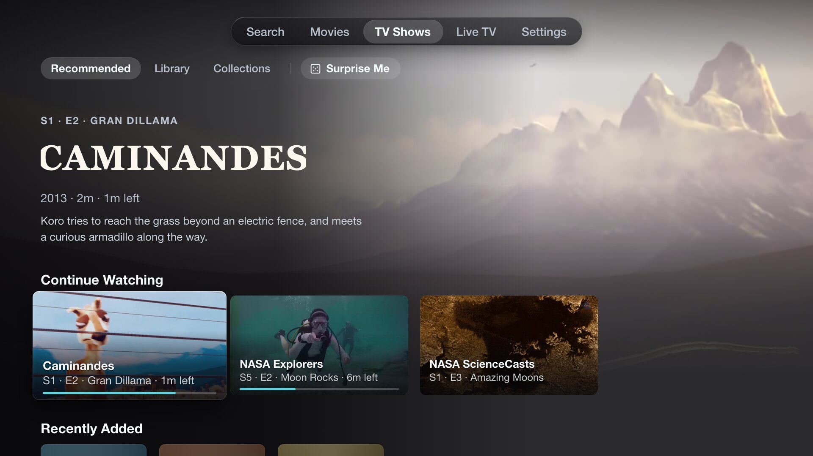 | 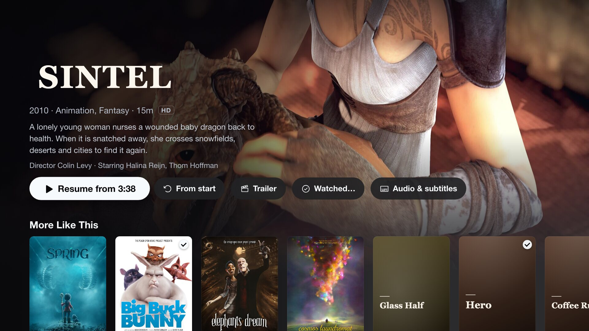 |
| 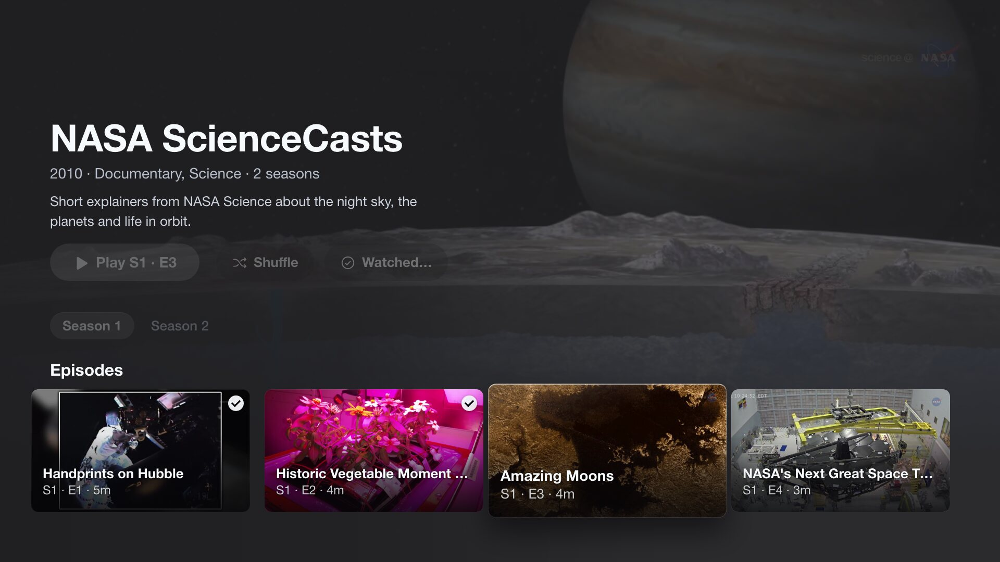 | 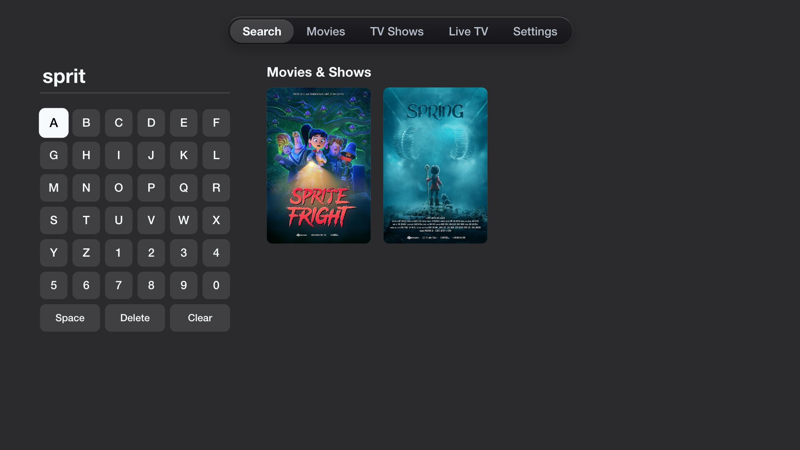 |
| 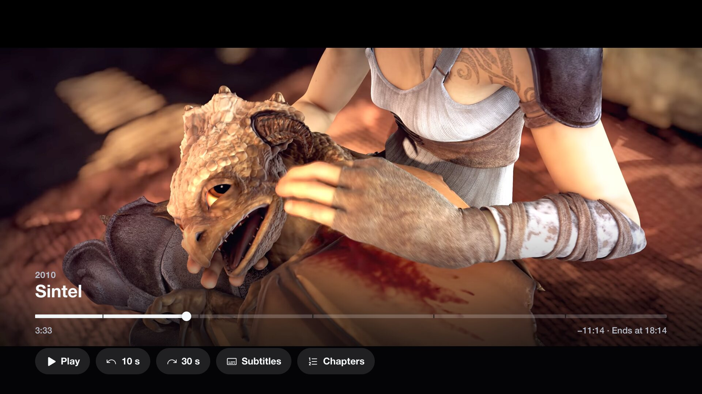 | 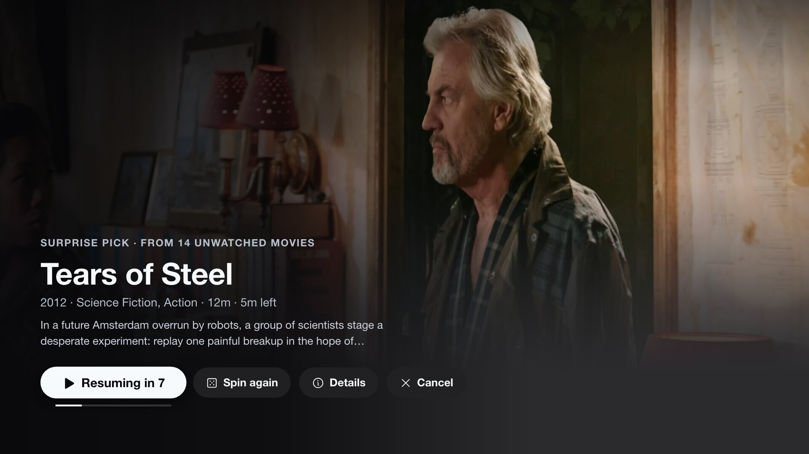 |

<sub>Shown with a demo library of Blender open movies and public-domain films ([credits](docs/screenshots/CREDITS.md)).
More in [Screenshots](#screenshots).</sub>

## Features

- **Libraries**: Recommended, Library (sort, genre, decade, unwatched) and Collections views for
  movies and TV, with an A–Z rail to jump to a letter (see [Jump to a letter](#jump-to-a-letter))
- **Title pages**: cast and crew, trailers and extras, ratings, versions, seasons and episodes, and
  a page for each person
- **Player**: direct play (H.264/HEVC including 10-bit, in MKV/MP4) or server transcoding when
  needed. Resume, a chapter-segmented seek bar you can jump along or scrub with a preview,
  subtitle and audio menus that keep the video playing, Info / Chapters / Episodes tabs, Skip Intro
  and Skip Credits, and an end-of-episode card with autoplay (see [Player](#player)).
- **Search as you type**: typo-tolerant fuzzy search over your libraries, plus episodes and people
  from the server
- **Live TV**: guide and playback through Plex Live TV & DVR
- **Accounts**: sign in with a plex.tv/link code, switch Plex Home profiles (not PIN-protected ones
  yet), set server addresses manually when discovery doesn't work
- **Remote**: built for the arrow keys, with pointer (Magic Remote) support. Hold OK for quick
  actions (resume, play from the beginning, mark watched or unwatched). The number keys jump to a
  letter in the Library view.
- **Plugins**: optional add-ons for rows, actions and settings (see [Plugins](#plugins))
- **Surprise Me**: for when nobody can decide what to watch (see [Surprise Me](#surprise-me))

## Jump to a letter

When the Library view is sorted by title, a slim **#, A–Z** rail sits at the right edge of the poster
grid. The letter of the focused title is highlighted as you scroll, and letters with no titles are
dimmed.

| Key | What it does |
| --- | --- |
| Right (from the last column) | Moves into the rail, on the current letter |
| Up / Down (in the rail) | Moves between letters that have titles (Up from the top letter goes to the filters when the grid is at its first row) |
| OK (in the rail) | Jumps to the first title of that letter and focuses it |
| Left or Back (in the rail) | Back to the grid where you were, without jumping |
| 2–9 | Jumps like a phone keypad: 2 = A, press again for B, then C; 7 = P Q R S, 9 = W X Y Z |
| 0 or 1 | Jumps to # (titles starting with a digit or symbol) |

With the Magic Remote, click a letter. The jump honours the Genre, Decade and Unwatched filters, and
a Z–A title sort flips the rail. With any other sort the rail is hidden (the number keys say to sort
by Title), because letters don't mark positions in a list sorted by date or rating.

A jump costs one small request when the filters change (Plex's `firstCharacter` counts per letter,
about 1 KB) and then only the page of titles around the target, however far down it is.

## Player

Nothing is on screen while you watch. Any key brings up the controls: the title, a seek bar split
into the title's chapters, the elapsed and remaining time, round icons for Subtitles, Audio (with
more than one track) and Next episode, and tabs for Info, Chapters and Episodes. They hide after 5
seconds while playing and stay up while paused, scrubbing or with a menu or tab open.

| Key | Watching (controls hidden) | Seek bar | Icons, menus, tabs |
| --- | --- | --- | --- |
| Left / Right | Jump back 10 s / forward 30 s (and show the controls) | Jump back 10 s / forward 30 s at once; hold to scrub with a preview. Paused: move the scrub target | Move between icons, tabs or cards |
| OK | Skip Intro / Credits or the end card's button when shown, else show the controls | Pause or play; while scrubbing, jump to the target and play | Open the menu, choose, play the chapter or episode |
| Up / Down | Show the controls | Up: the icons. Down: the tabs | Back towards the bar (Down from icons, Up from tabs) |
| Back | Dismiss Skip Intro or the end card, else leave the player | Return from a scrub, else hide the controls | Close the menu or tab |
| Play, Pause, Play/Pause | Play or pause (OK after scrubbing) | | |
| Fast-forward, Next track | In an intro: jump to its end. In marked end credits: next episode (or finish). Otherwise forward 30 s | | |
| Rewind, Previous track | Back 10 s | | |
| Stop | Leave the player | | |

Scrubbing pauses the picture and moves a target along the bar; a teal tick marks where you were,
and OK jumps there (Back returns). A large time with the chapter name rides above the target; when the
server makes preview thumbnails (Plex settings, Library, "Generate video preview thumbnails"), the
frame is shown there instead. The TV can only start playback at keyframes, so a jump can land a few seconds off.
Subtitles and Audio open a small menu above their icon while the video keeps playing; picture
subtitles (PGS, VobSub) are burned in by the server. Skip Intro and Skip Credits appear from Plex's
intro and credits markers, which the server creates when intro and credits detection is on (Plex
settings, Library). The button has the focus while it is shown, stays for 10 seconds, and comes back
whenever you open the controls during the intro or credits. At the end credits of an episode with a
next one, a card offers Watch Credits and Next Episode (counting down when autoplay is on). With
the Magic Remote, point and click: hovering focuses, the seek bar jumps where you click (hover to
see the time). The LG Magic Remote (MR19) has Play and Pause keys but no fast-forward, so use OK on
Skip Intro there.

## Surprise Me

A **Surprise Me** pill sits after Recommended / Library / Collections in the Movies and TV Shows
tabs (Up from the rows, then Right). It picks something at random and shows it full screen (art,
title logo, year, runtime, a two-line summary) with an 8-second countdown, then plays it. Play now,
Spin again, Details and Cancel are on screen. Moving between them stops the countdown, and Back
cancels.

- It picks from unwatched titles. If everything has been watched, it picks from all of them and
  says it's a rewatch. Settings has "Surprise Me: include watched" and "Surprise Me: autoplay
  countdown".
- In the Library view it uses the active Genre and Decade filters (the pill shows them), and the
  Unwatched filter makes "unwatched only" strict.
- Movies resume where they were left. Shows play their next episode (Plex's On Deck, which is S1 E1
  for a show that was never started), or the first regular episode for a finished show.
- A collection's page (2+ titles) has its own Surprise Me pill after the title (Up from the first
  row). It picks among that collection's titles by the same rules.
- Watched state is the current Plex Home profile's. The last 15 picks per library or collection and
  profile are remembered (in the TV's local storage, so across restarts) and skipped, so neither
  Spin again nor tomorrow's spin brings them straight back.
- It costs one request for 12 random titles (`sort=random`), plus one for a show's next episode. The
  art (1280x720, as in the hero) and logo are preloaded so the reveal draws complete.

## Screenshots

All at 1920x1080, from the desktop build against the demo library in `tools/demo/` (Blender open
movies, public-domain classics and NASA shorts; no personal library). Desktop Chromium draws a little
differently from the TV's Chrome 53. Credits and licences: [docs/screenshots/CREDITS.md](docs/screenshots/CREDITS.md).

| | |
| --- | --- |
| 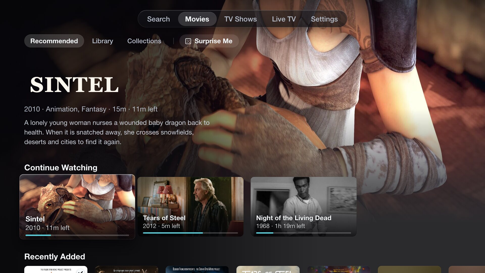 | 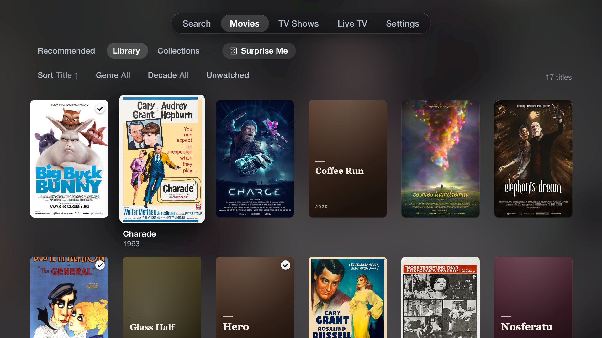 |
| 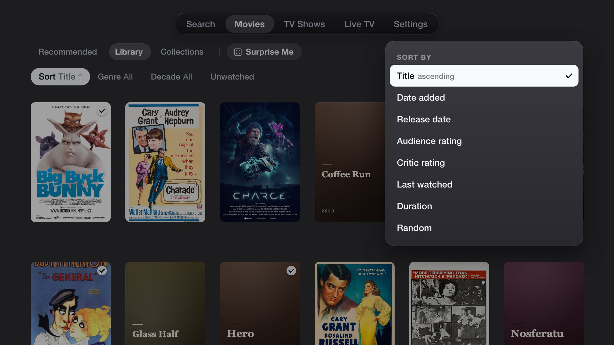 | 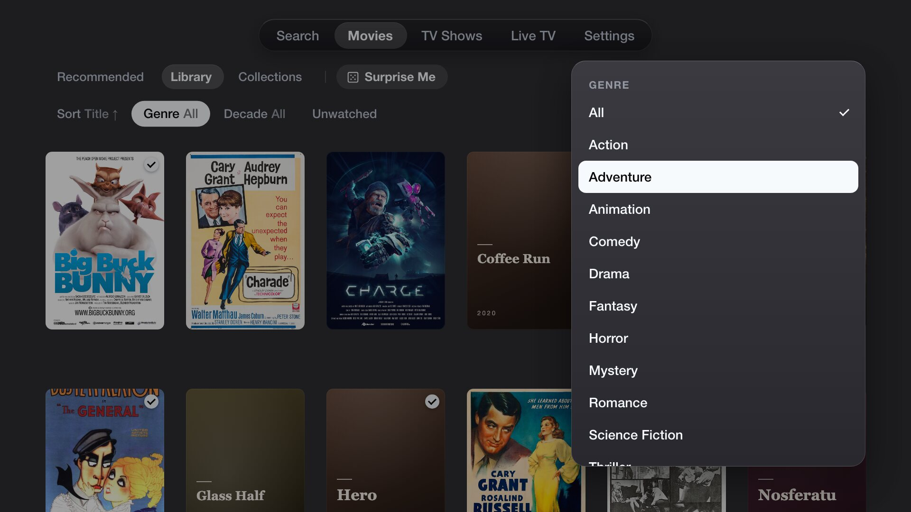 |
| 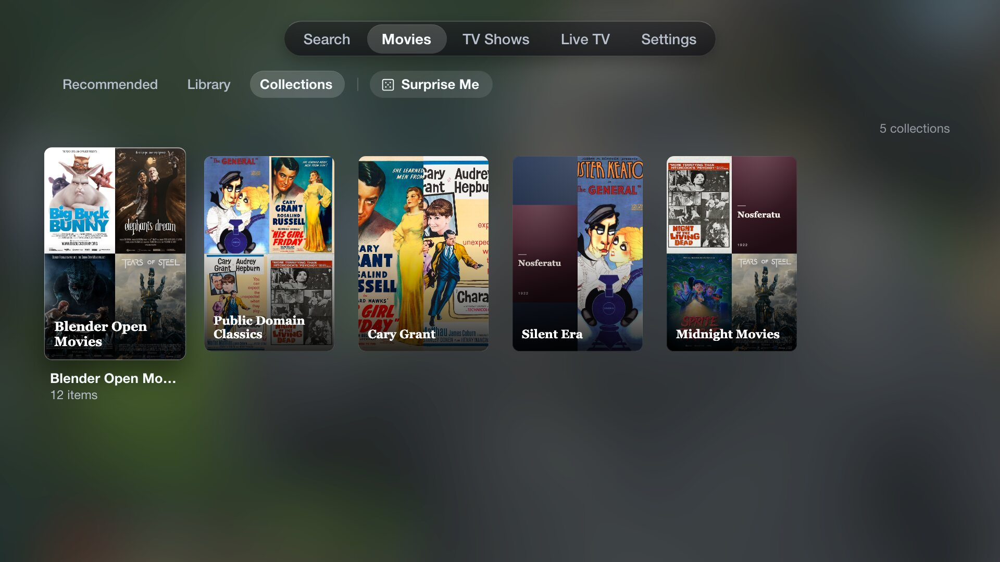 | 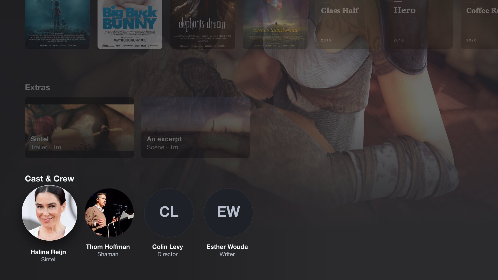 |
| 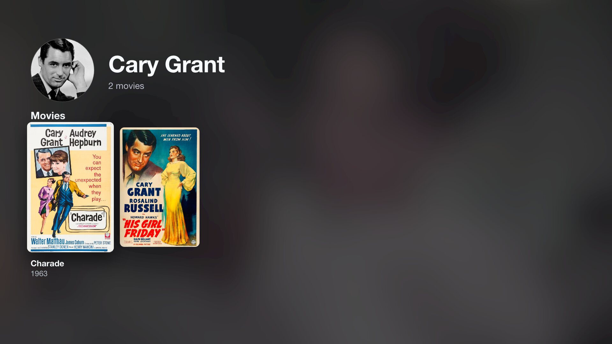 | 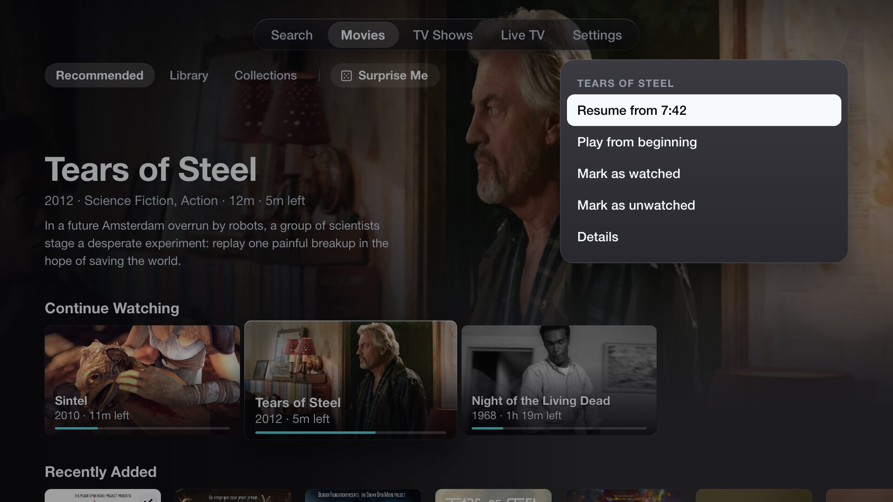 |
| 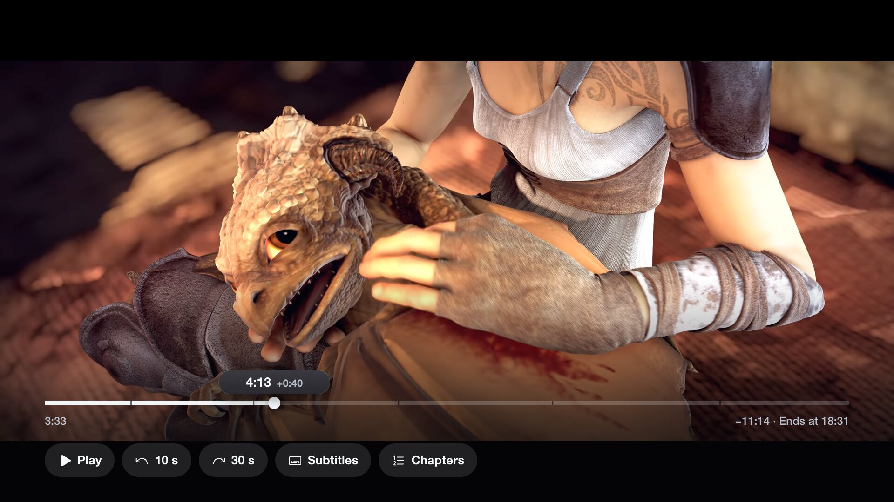 | 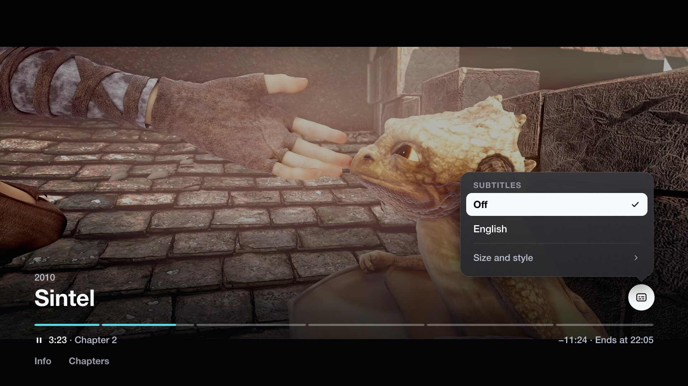 |
| 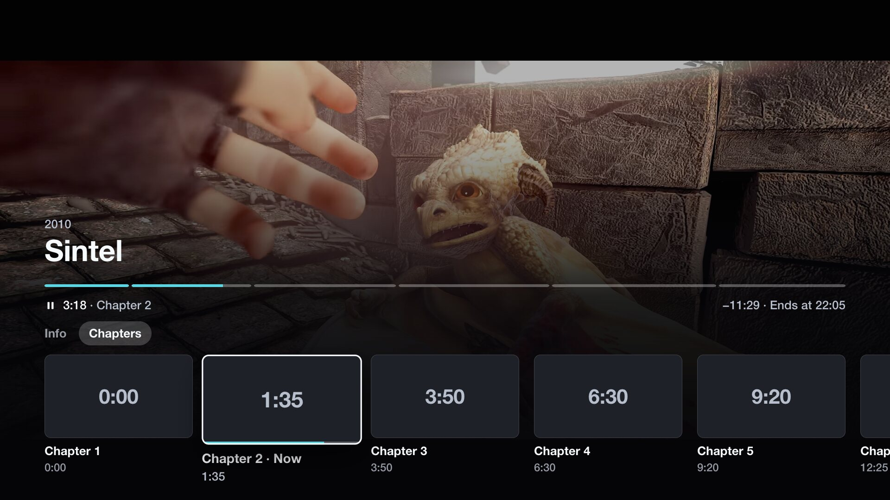 | |
|  | 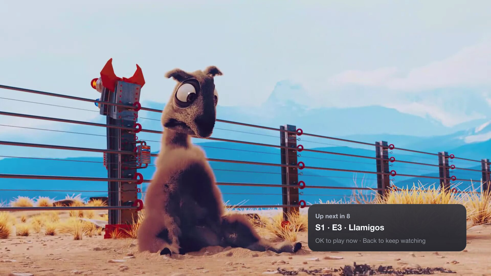 |
| 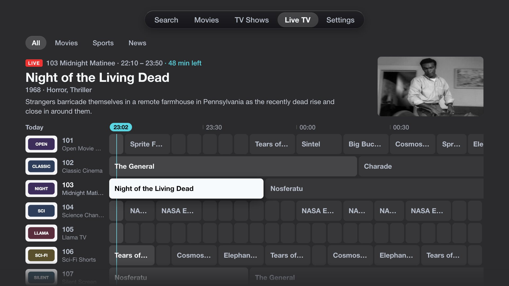 | 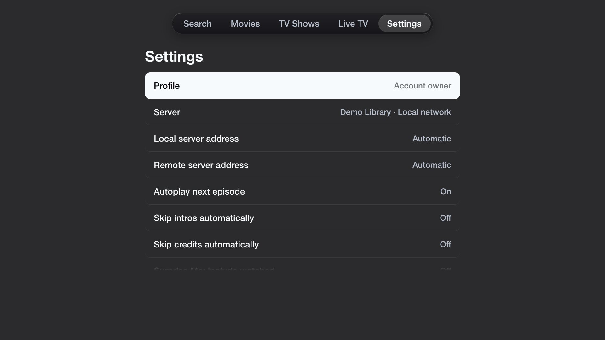 |
| 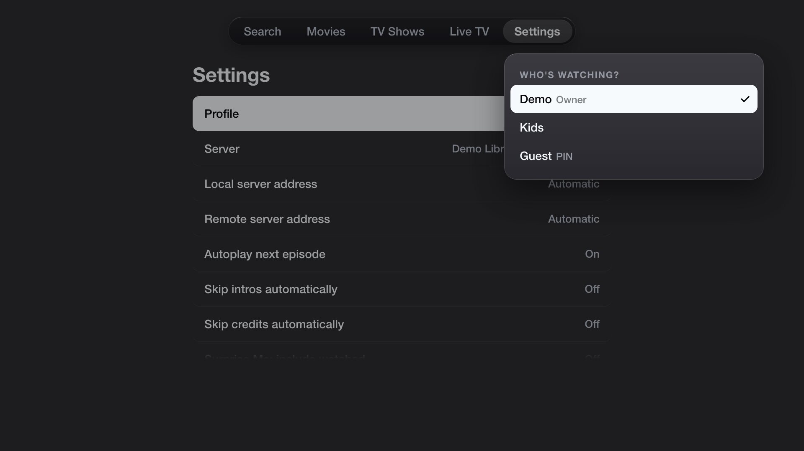 | 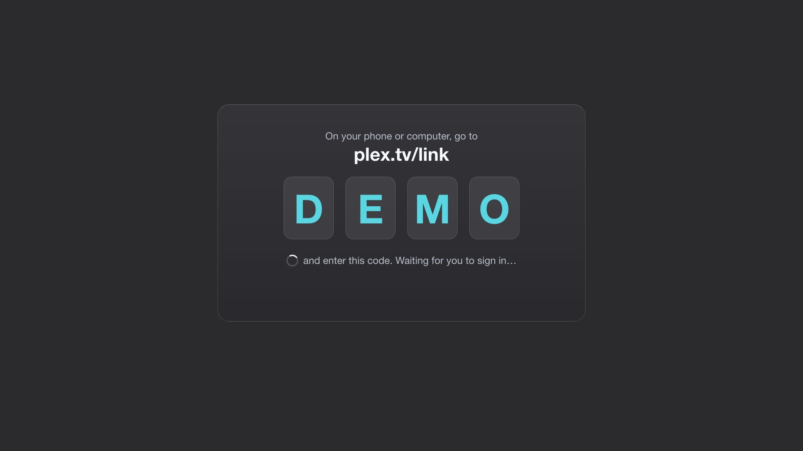 |

To retake them: `node tools/demo/fetch-media.mjs`, then `node tools/demo/shots.mjs` (see
[Development](#development)). `tools/shots.mjs` takes review screenshots on a real TV, which show your
own library: don't publish those.

## Requirements

- An LG TV with **webOS 4.5**. That is the version it is developed and tested on (2019 models).
  Later webOS versions have newer browser engines and should work, but they're untested. Earlier
  ones are not supported.
- One of the following, to install an app that isn't from the LG Content Store:
  - a **rooted** TV with the [webOS Homebrew Channel](https://github.com/webosbrew/webos-homebrew-channel)
    (see [rootmy.tv](https://rootmy.tv) and
    [faultmanager-autoroot](https://github.com/throwaway96/faultmanager-autoroot)), or
  - **Developer Mode** (the LG "Developer Mode" app and a free LG developer account). Dev-mode
    apps are removed when the dev-mode session expires unless you extend it.
- A **Plex Media Server** that is linked to your Plex account and that the TV can reach. Live TV
  needs a tuner set up in Plex.

## Install

Download the latest `.ipk` from the Releases page, or build it yourself
(see [Building](#building)).

- **Homebrew Channel (rooted)**: install the IPK with
  [webOS Dev Manager](https://github.com/webosbrew/dev-manager-desktop), or copy it to the TV and
  run, over SSH:

  ```sh
  luna-send -n 1 luna://com.webos.appInstallService/dev/install \
    '{"id":"com.bednal.plexlite","ipkUrl":"/tmp/plexlite.ipk","subscribe":true}'
  ```

- **Developer Mode**: install with webOS Dev Manager or the LG CLI (`ares-install plexlite.ipk`).

Plex Lite then appears in the launcher.

## First run

1. Open Plex Lite. It shows a short code.
2. On a phone or computer, go to **plex.tv/link**, sign in and enter the code.
3. Plex Lite finds your servers and connects to the best address: local first, then remote, then
   the Plex relay. With Plex Home, switch profile under **Settings → Profile** (profiles with a PIN
   are not supported yet).
4. If the server isn't found automatically, set its address under **Settings → Local server
   address** (for example `http://192.168.0.10:32400`) or **Remote server address**.

Your Plex token stays on the TV, in the app's own storage. It is sent only to plex.tv and to
servers linked to your account. If you set up the Overseerr plugin, it is also used once to sign in
to the Overseerr address you enter.

## Plugins

Plugins add rows, actions and settings without touching the app's screens. They currently ship
inside the app and are reviewed like any other code. Each one can be switched off under
**Settings → Plugin · <name>**.

- **Overseerr** (`plugins/overseerr/`, also works with Seerr): request movies and shows that aren't
  in your library, from Search; see what's downloading (a Downloading screen, a shelf and a badge on
  title pages); and report a problem with a title (bad quality, wrong language, out of sync…), which
  creates an Overseerr issue under your own account. It signs in with your Plex profile through a
  small webOS background service, because the app itself can't hold Overseerr's session cookie.
  See [docs/OVERSEERR.md](docs/OVERSEERR.md).

To write your own, see [docs/PLUGINS.md](docs/PLUGINS.md).

## Building

Building needs Python 3 and nothing else:

```sh
python3 tools/build-ipk.py dist/plexlite.ipk
```

This packages `appinfo.json`, `index.html`, `css/`, `js/`, `img/` and `plugins/`, and installs any
plugin `service/` folder as a webOS JS service.

### App id

The app id is `com.bednal.plexlite` (in `appinfo.json`). To build under your own id, for example
for a fork:

```sh
python3 tools/build-ipk.py dist/myplex.ipk --app-id com.example.plexlite
# or: PLEXLITE_APP_ID=com.example.plexlite python3 tools/build-ipk.py ...
```

The build replaces the id in every packaged file, so plugin services follow it
(`com.example.plexlite.service`). webOS treats a different id as a **different app**. It installs
next to the original and has its own storage, so you sign in again.

### Versioning

Versions follow [semver](https://semver.org) and live in two places that `tools/check.mjs` keeps
in step: `appinfo.json` `version` (webOS needs plain `x.y.z`) and `PL.VERSION` in `js/core.js`
(reported to Plex and shown under Settings → About). Every release gets an entry in
[CHANGELOG.md](CHANGELOG.md) and a `vX.Y.Z` git tag.

### Icons

The app icon is `assets/icon.svg`. `python3 tools/make-icons.py` renders it to `img/icon.png`
(80x80) and `img/largeIcon.png` (130x130). It uses `rsvg-convert` or headless Chrome.

## Development

The dev tools read their settings from environment variables, from `tools/local.env`
(git-ignored) or from `~/.config/plexlite/config.env`. Copy
[tools/local.env.example](tools/local.env.example) to get started. Nothing about your TV, server or
account belongs in the repo.

| Tool | What it does |
| --- | --- |
| `tools/deploy.sh [--dev] [--no-launch]` | Builds, installs on the TV over SSH (`PLEXLITE_TV_SSH`, root or dev mode) and launches. `--dev` embeds a Plex token from `PLEX_ENV_FILE` so the TV skips sign-in. Dev builds go to `~/.cache/plexlite`, never into the repo. |
| `node tools/check.mjs` | Checks JS and CSS against Chrome 53 and that the versions match. Run it before every commit. |
| `node --test test/` | All unit tests (search, A–Z rail offsets, plugins, Overseerr). `node test/fuzzy.test.mjs` alone adds a small search benchmark. |
| `node tools/devserver.mjs` | Serves the app on the desktop at http://127.0.0.1:8920 with a read-only Plex proxy. The browser never sees your real token. |
| `node tools/demo/server.mjs` | Runs the app on the desktop at http://127.0.0.1:8930 against a mock Plex server and plex.tv with a demo library of openly licensed films, so no Plex account or server is needed. Run `node tools/demo/fetch-media.mjs` once first for the artwork. See [tools/demo/README.md](tools/demo/README.md). |
| `node tools/demo/shots.mjs` | Retakes the README screenshots in `docs/screenshots/` from the demo server (needs `playwright-core`, installed outside the repo). |
| `node tools/tvdebug.mjs …` | Talks to the TV's web runtime over DevTools: eval, key presses, logs, traces, screenshots. Needs `ssh -f -N -L 19998:127.0.0.1:9998 "$PLEXLITE_TV_SSH"`. |
| `node tools/shots.mjs <dir>` | Screenshots every page at 0, 3 and 10 seconds for visual review. |
| `python3 tools/make-icons-js.py <phosphor-core>` | Regenerates `js/icons.js` from `@phosphor-icons/core`. |

Design notes: [docs/DESIGN.md](docs/DESIGN.md) (visual language) and
[docs/MOTION.md](docs/MOTION.md) (animation).

## Contributing

See [CONTRIBUTING.md](CONTRIBUTING.md). In short: everything must run on Chrome 53, so write ES5
plus the few ES2015 features it supports, avoid newer CSS, and run `node tools/check.mjs` and the
tests before sending a pull request.

## Credits

- [Phosphor Icons](https://phosphoricons.com) (MIT) for the UI icons
- [PlxNative](https://github.com/GLinnik21/plx-native) for design inspiration: Plex Lite's look and
  motion were informed by studying it. No code was copied.
- [Hearth](https://github.com/rudra-avatar/Hearth) (MIT) and the launchers it builds on
  ([webos-launcher](https://github.com/partridgeworks/webos-launcher),
  [glasshouse](https://github.com/rorygallagher2024/glasshouse)). Hearth can open titles in Plex
  Lite directly.
- [webOS Homebrew Channel](https://github.com/webosbrew/webos-homebrew-channel) and the webosbrew
  community
- [faultmanager-autoroot](https://github.com/throwaway96/faultmanager-autoroot) for rooting webOS TVs

Licences and details: [THIRD-PARTY-NOTICES.md](THIRD-PARTY-NOTICES.md).

## Licence and trademarks

Plex Lite is released under the [MIT licence](LICENSE). Copyright (c) 2026 Bednal Limited.

Plex is a trademark of Plex, Inc. LG and webOS are trademarks of LG Electronics Inc. This project
is not affiliated with or endorsed by either company. The names describe only what the software
works with.
